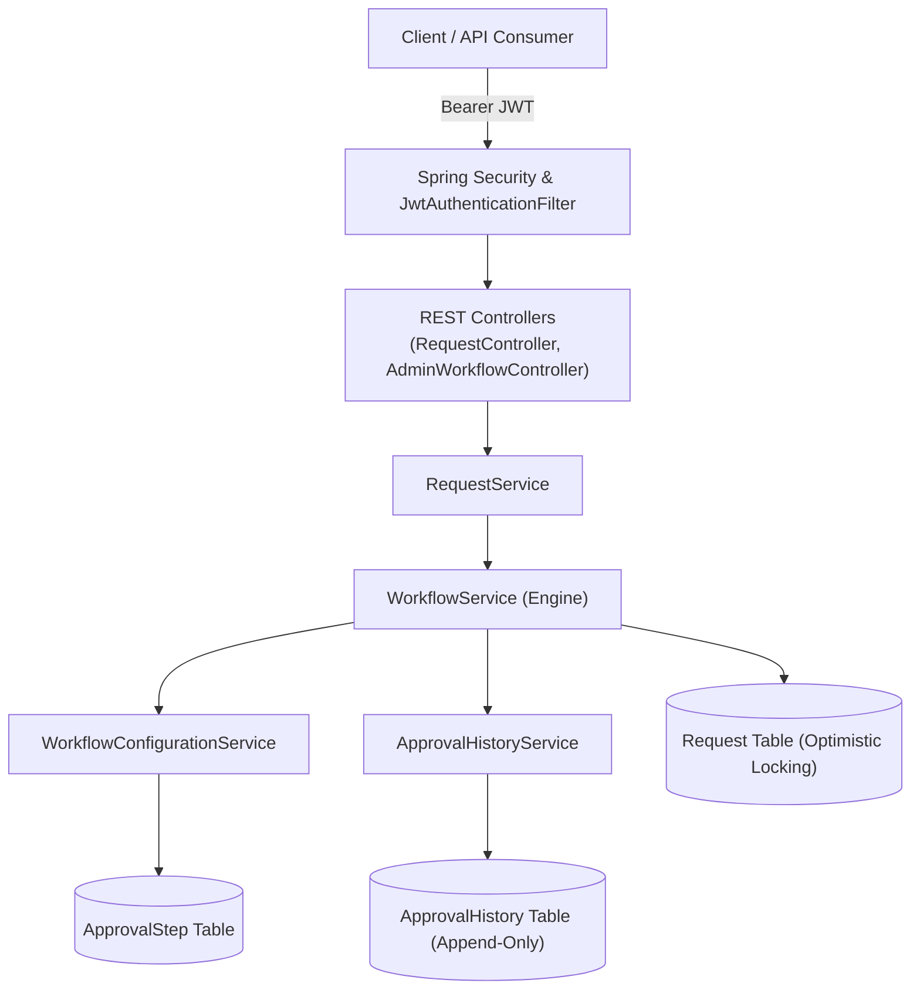
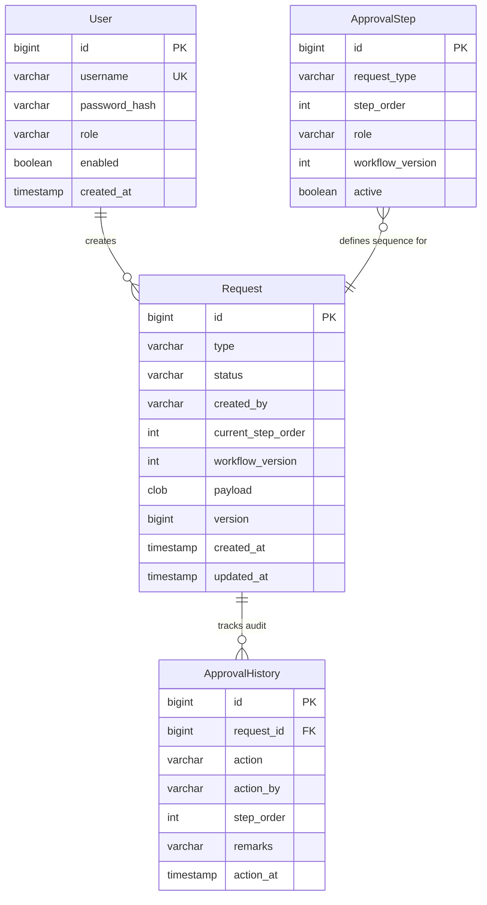
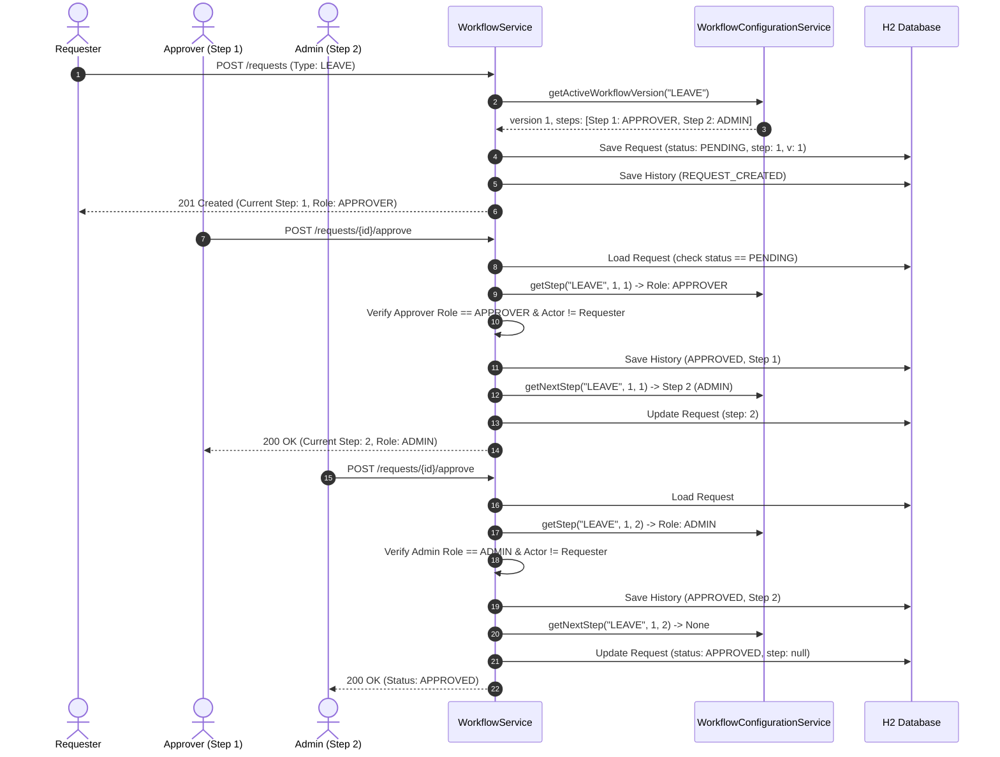

# Configurable Approval Workflow Engine — Production-Minded Backend

An enterprise-grade, metadata-driven approval workflow engine built with **Java 21**, **Spring Boot 3.3.5**, **Spring Security (stateless JWT)**, **Spring Data JPA / Hibernate**, and an in-memory **H2 database**.

---

## Table of Contents

1. [Project Overview](#1-project-overview)
2. [Problem Statement and Solution](#2-problem-statement-and-solution)
3. [Technology Stack](#3-technology-stack)
4. [Architecture and Package Structure](#4-architecture-and-package-structure)
5. [Database Entity Descriptions and Relationships](#5-database-entity-descriptions-and-relationships)
6. [Explanation of the Configurable Workflow Engine](#6-explanation-of-the-configurable-workflow-engine)
7. [Explanation of Why Approval Logic is Not Hardcoded](#7-explanation-of-why-approval-logic-is-not-hardcoded)
8. [Sample LEAVE and EXPENSE Workflow Configurations](#8-sample-leave-and-expense-workflow-configurations)
9. [Authentication and JWT Flow](#9-authentication-and-jwt-flow)
10. [Role-Based Authorization Rules](#10-role-based-authorization-rules)
11. [API Endpoint Table with Roles and Methods](#11-api-endpoint-table-with-roles-and-methods)
12. [Example Requests and Responses](#12-example-requests-and-responses)
13. [Admin Override Behavior](#13-admin-override-behavior)
14. [Transaction and Concurrency Handling](#14-transaction-and-concurrency-handling)
15. [Test Execution Commands](#15-test-execution-commands)
16. [Actual Test Coverage Result and Report Location](#16-actual-test-coverage-result-and-report-location)
17. [Prerequisites and Setup Instructions](#17-prerequisites-and-setup-instructions)
18. [How to Run the Application in Development Mode](#18-how-to-run-the-application-in-development-mode)
19. [How to Obtain a JWT and Test APIs](#19-how-to-obtain-a-jwt-and-test-apis)
20. [Sample Development Credentials](#20-sample-development-credentials)
21. [Known Limitations and Design Decisions](#21-known-limitations-and-design-decisions)
22. [GitHub Submission Instructions](#22-github-submission-instructions)

---

## 1. Project Overview

The **Configurable Approval Workflow Engine** is a backend service designed for processing multi-step, multi-stage approval processes (such as Employee Leave Requests, Expense Reimbursements, and Purchase Orders) without hardcoding business routes into the application codebase. 

All workflow definitions, sequential step orders, and authorizing roles reside directly in the database. Adding new request types or re-sequencing existing approval flows can be performed purely via database configuration without recompilation or redeployment.

---

## 2. Problem Statement and Solution

### The Problem
Traditional workflow systems frequently implement approvals with conditional branching logic:
```java
// ANTI-PATTERN: Brittle hardcoded branching
if ("LEAVE".equals(request.getType())) {
    if (step == 1) verifyRole(Role.APPROVER);
    else if (step == 2) verifyRole(Role.ADMIN);
} else if ("EXPENSE".equals(request.getType())) {
    // ...
}
```
This hardcoding leads to architectural rigidity:
- Adding a new request type (e.g., `PURCHASE_ORDER`) requires modifying core engine code.
- Altering the approval sequence (e.g., adding a compliance officer check) breaks existing workflows.
- In-flight requests risk becoming corrupted when business rules change midway.

### The Solution
The engine treats workflow definitions as **pure data**:
1. **Dynamic Step Resolution**: When an approval occurs, the engine dynamically queries the active `ApprovalStep` matching `(requestType, workflowVersion, currentStepOrder)`.
2. **Workflow Versioning (Snapshots)**: Every request records the `workflowVersion` active at its moment of creation. Updating a workflow in the database does not disrupt in-flight requests.
3. **Generic Step Advancement**: The engine discovers the subsequent step simply by querying for `currentStepOrder + 1`. If none exists, the workflow is automatically marked `APPROVED`. If a rejection occurs at any point, the workflow enters `REJECTED` and terminates.
4. **Optimistic Locking**: Concurrent advancement attempts are prevented via JPA `@Version` optimistic locking, avoiding duplicate or out-of-order state transitions.
5. **Immutable Audit Trail**: An append-only `approval_history` table records every lifecycle event (`REQUEST_CREATED`, `APPROVED`, `REJECTED`, `ADMIN_OVERRIDE_APPROVED`, `ADMIN_OVERRIDE_REJECTED`) with server-stamped timestamps and verified identities.

---

## 3. Technology Stack

- **Language & Runtime**: Java 21 (LTS)
- **Framework**: Spring Boot 3.3.5
- **Security**: Spring Security 6.3, stateless JWT (`jjwt-api` / `jjwt-impl` / `jjwt-jackson` 0.12.6) with HMAC-SHA256, BCrypt password hashing
- **Persistence**: Spring Data JPA, Hibernate 6.5
- **Database**: H2 In-Memory Database (`jdbc:h2:mem:workflowdb`)
- **Validation**: Jakarta Bean Validation (`spring-boot-starter-validation`)
- **Documentation**: SpringDoc OpenAPI / Swagger UI 2.6.0
- **Testing**: JUnit 5, Mockito, Spring Boot Test, Spring Security Test, MockMvc
- **Code Coverage**: JaCoCo Maven Plugin 0.8.12 (enforcing minimum 80% line coverage)
- **Build Tool**: Apache Maven 3.9.9 / Maven Wrapper (`mvnw`)

---

## 4. Architecture and Package Structure

The system uses a clean, layered architectural pattern with strict separation of concerns:

```
src/main/java/com/example/workflow/
├── ApprovalWorkflowEngineApplication.java  # Application entry point
├── config/                                 # Configuration beans
│   ├── DatabaseSeeder.java                 # Bootstraps dev users & workflow definitions
│   ├── OpenApiConfig.java                  # Swagger / OpenAPI 3.0 documentation
│   └── SecurityConfig.java                 # Spring Security filter chain & exception entry points
├── controller/                             # REST controllers (thin layer)
│   ├── AdminWorkflowController.java        # Admin override endpoints (/admin/requests/**)
│   ├── AuthenticationController.java       # Public auth endpoints (/auth/**)
│   └── RequestController.java              # Request management & workflow actions (/requests/**)
├── dto/                                    # Data transfer objects with validation annotations
│   ├── AdminOverrideDto.java
│   ├── ApprovalHistoryDto.java
│   ├── ApproveRequestDto.java
│   ├── AuthRequest.java
│   ├── AuthResponse.java
│   ├── CreateRequestDto.java
│   ├── ErrorResponse.java
│   ├── RegisterRequest.java
│   ├── RejectRequestDto.java
│   └── RequestResponseDto.java
├── entity/                                 # JPA entities
│   ├── ApprovalHistory.java                # Immutable append-only audit trail
│   ├── ApprovalStep.java                   # Database-driven workflow step definitions
│   ├── Request.java                        # Approval request with optimistic locking
│   └── User.java                           # User credentials and role
├── enums/                                  # Domain enums
│   ├── HistoryAction.java
│   ├── RequestStatus.java
│   └── Role.java
├── exception/                              # Centralized error handling
│   ├── GlobalExceptionHandler.java         # RestControllerAdvice mapping to HTTP codes
│   ├── InvalidWorkflowException.java       # 400 Bad Request
│   ├── ResourceNotFoundException.java      # 404 Not Found
│   ├── UnauthorizedActionException.java    # 403 Forbidden
│   ├── UserAlreadyExistsException.java     # 409 Conflict
│   └── WorkflowTransitionException.java    # 409 Conflict
├── mapper/                                 # Entity <-> DTO mappers
│   └── DtoMapper.java
├── repository/                             # Spring Data JPA repositories
│   ├── ApprovalHistoryRepository.java
│   ├── ApprovalStepRepository.java
│   ├── RequestRepository.java
│   └── UserRepository.java
├── security/                               # Security components
│   ├── CustomUserDetailsService.java       # Loads user details & authorities
│   ├── JwtAuthenticationFilter.java        # Stateless OncePerRequestFilter for Bearer tokens
│   ├── JwtService.java                     # Token creation & verification
│   └── SecurityUtils.java                  # Extracts authenticated principal safely
└── service/                                # Service interfaces & implementations
    ├── ApprovalHistoryService.java
    ├── AuthenticationService.java
    ├── RequestService.java
    ├── WorkflowConfigurationService.java   # Dynamic DB query service for steps
    ├── WorkflowService.java                # Core workflow execution engine
    └── impl/
        ├── ApprovalHistoryServiceImpl.java
        ├── AuthenticationServiceImpl.java
        ├── RequestServiceImpl.java
        ├── WorkflowConfigurationServiceImpl.java
        └── WorkflowServiceImpl.java
```

### High-Level Architecture Diagram



---

## 5. Database Entity Descriptions and Relationships



### Entity Fields:
1. **User (`users`)**:
   - `id`: Auto-generated primary key.
   - `username`: Unique username (indexed).
   - `passwordHash`: BCrypt-hashed password. Plaintext passwords are never stored.
   - `role`: Role enum (`REQUESTER`, `APPROVER`, `ADMIN`).
   - `enabled`: Boolean flag.
   - `createdAt`: UTC creation timestamp.

2. **ApprovalStep (`approval_steps`)**:
   - `id`: Auto-generated primary key.
   - `requestType`: Request type identifier (e.g., `LEAVE`, `EXPENSE`, `PURCHASE_ORDER`).
   - `stepOrder`: 1-based sequential position in the approval chain.
   - `role`: Role permitted to approve this step (`APPROVER`, `ADMIN`, etc.).
   - `workflowVersion`: Version number of the workflow configuration.
   - `active`: Configuration flag.
   - *Constraint*: Unique constraint on `(request_type, workflow_version, step_order)`.

3. **Request (`requests`)**:
   - `id`: Auto-generated primary key.
   - `type`: Target workflow request type.
   - `status`: Lifecycle state (`PENDING`, `APPROVED`, `REJECTED`).
   - `createdBy`: Username extracted from authenticated JWT context.
   - `currentStepOrder`: Currently active step order; set to `null` once terminal state is reached.
   - `workflowVersion`: Workflow version snapshot locked at request creation.
   - `payload`: Flexible JSON CLOB containing business data.
   - `version`: `@Version` optimistic locking token for concurrency protection.
   - `createdAt`, `updatedAt`: Timestamps.

4. **ApprovalHistory (`approval_history`)**:
   - `id`: Auto-generated primary key.
   - `requestId`: Foreign key reference to the request.
   - `action`: Audit action (`REQUEST_CREATED`, `APPROVED`, `REJECTED`, `ADMIN_OVERRIDE_APPROVED`, `ADMIN_OVERRIDE_REJECTED`).
   - `actionBy`: Username of actor performing the action.
   - `actionAt`: Server-generated timestamp.
   - `stepOrder`: Active step order at the moment of the event.
   - `remarks`: Optional or mandatory comment string.
   - *Rule*: Append-only. No application operation supports update or deletion.

---

## 6. Explanation of the Configurable Workflow Engine



The workflow engine functions via five distinct generic phases:
1. **Request Creation (`processCreation`)**:
   - Queries `WorkflowConfigurationService` for the active version and ordered step list of the requested `type`.
   - Rejects the operation if no active workflow configuration exists in the database.
   - Initializes the request to `PENDING` with `currentStepOrder = 1` and records the initial `REQUEST_CREATED` audit entry.
2. **Step Resolution & Authorization**:
   - Determines the current step by loading the `ApprovalStep` for `(request.type, request.workflowVersion, request.currentStepOrder)`.
   - Validates that the request status is `PENDING`.
   - Enforces self-approval prevention: `request.createdBy != actorUsername`.
   - Enforces role match: `actor.role == currentStep.role`.
3. **Approval Progression (`processApproval`)**:
   - Records an `APPROVED` event in the audit trail.
   - Asks the configuration service for the step matching `currentStepOrder + 1`.
   - If a next step exists, advances `currentStepOrder` to that step.
   - If no next step exists, transitions the status to `APPROVED` and sets `currentStepOrder` to `null`.
4. **Rejection Termination (`processRejection`)**:
   - Verifies authorization identical to approval.
   - Records a `REJECTED` event in the audit trail.
   - Transitions the status to `REJECTED` and terminates the workflow (`currentStepOrder = null`).
5. **Administrator Override (`processAdminOverride`)**:
   - An administrator can override any request to `APPROVED` or `REJECTED` at any time.
   - Requires mandatory explanatory remarks.
   - Rejects repeated transitions to the current status (idempotency safety).
   - Atomically records `ADMIN_OVERRIDE_APPROVED` or `ADMIN_OVERRIDE_REJECTED` without destroying prior audit history.

---

## 7. Explanation of Why Approval Logic is Not Hardcoded

In strict compliance with the core architectural requirements:

> **CRITICAL RULE**: The engine must use generic, database-driven workflow processing. Adding a new request type or changing its approval sequence must not require modifying the workflow engine's business logic.

In `WorkflowServiceImpl.java`, there are **zero** conditional checks on request types (e.g. `if (type.equals("LEAVE"))`), **zero** hardcoded step sequences, and **zero** hardcoded role assumptions.

All step logic is expressed generically:
```java
// Generic step resolution directly from database
ApprovalStep currentStep = configurationService.getStep(
        request.getType(),
        request.getWorkflowVersion(),
        request.getCurrentStepOrder()
);

// Generic authorization matching
if (actor.getRole() != currentStep.getRole()) {
    throw new UnauthorizedActionException("Role mismatch: step requires " + currentStep.getRole());
}

// Generic progression: step N -> step N+1 -> terminal completion
Optional<ApprovalStep> nextStepOpt = configurationService.getNextStep(
        request.getType(),
        request.getWorkflowVersion(),
        currentStep.getStepOrder()
);
if (nextStepOpt.isPresent()) {
    request.setCurrentStepOrder(nextStepOpt.get().getStepOrder());
} else {
    request.setStatus(RequestStatus.APPROVED);
    request.setCurrentStepOrder(null);
}
```

This guarantees:
- Supporting a 1-step, 2-step, 3-step, or 10-step flow requires only inserting rows into `approval_steps`.
- Adding new request types (e.g., `CAPITAL_EXPENDITURE`, `TRAVEL_AUTHORIZATION`) requires no code changes.

---

## 8. Sample LEAVE and EXPENSE Workflow Configurations

The database is seeded with sample configurations:

### LEAVE Request Workflow (Version 1)
| Step Order | Authorizing Role | Description |
|:---:|:---:|:---|
| **1** | `APPROVER` | Team manager review and preliminary approval |
| **2** | `ADMIN` | HR administrator final sign-off |

### EXPENSE Request Workflow (Version 1)
| Step Order | Authorizing Role | Description |
|:---:|:---:|:---|
| **1** | `APPROVER` | Department supervisor expense audit |
| **2** | `ADMIN` | Finance director disbursement approval |

### Additional Seeded Workflows (Proving Generic N-Step Capability)
- **`PURCHASE_ORDER` (3 Steps)**:
  - Step 1: `APPROVER` (Department lead)
  - Step 2: `APPROVER` (Procurement officer)
  - Step 3: `ADMIN` (Executive VP)
- **`QUICK_REQUEST` (1 Step)**:
  - Step 1: `APPROVER` (Completes immediately upon single approval)

---

## 9. Authentication and JWT Flow

Authentication is completely stateless via JSON Web Tokens:

1. **Client Login**: Sends `username` and `password` to `POST /auth/login`.
2. **Verification**: Spring Security's `AuthenticationManager` verifies the credentials against the BCrypt password hash stored in the `users` table.
3. **Token Issuance**: `JwtService` issues a signed HMAC-SHA256 JWT containing `sub` (username) and custom claim `role`.
4. **Subsequent API Requests**: The client includes the token in the HTTP header:
   ```http
   Authorization: Bearer <jwt-token>
   ```
5. **Security Filter**: `JwtAuthenticationFilter` intercepts each request, verifies the cryptographic signature and token expiration, loads the user authorities, and sets the authenticated principal in Spring's `SecurityContextHolder`.

---

## 10. Role-Based Authorization Rules

| Role | Permissions & Boundaries |
|:---|:---|
| `REQUESTER` | Can register new accounts. Can submit new requests (`POST /requests`). Can view own request details (`GET /requests/{id}`). Can view own approval audit history (`GET /requests/history/{id}`). **Cannot approve or reject any request, including their own.** Cannot access requests created by other users. |
| `APPROVER` | Can view any request. Can approve or reject requests where the current configured `ApprovalStep.role` is `APPROVER`. **Cannot approve or reject requests they created.** Cannot invoke administrator overrides. |
| `ADMIN` | Can view any request. Can view full approval history for any request. Can perform approval steps configured for `ADMIN`. Can invoke emergency administrative overrides (`POST /admin/requests/{id}/override`) on any request at any stage. |

---

## 11. API Endpoint Table with Roles and Methods

| HTTP Method | Route | Authorized Roles | Description | Expected Status Codes |
|:---|:---|:---|:---|:---|
| `POST` | `/auth/login` | Public | Authenticates credentials and returns JWT token | 200, 400, 401 |
| `POST` | `/auth/register` | Public | Self-registration (REQUESTER/APPROVER only; ADMIN blocked) | 201, 400, 403, 409 |
| `POST` | `/requests` | `REQUESTER` | Creates a new workflow request at step 1 | 201, 400, 401, 403 |
| `GET` | `/requests/{id}` | `REQUESTER`, `APPROVER`, `ADMIN` | Retrieves request details and dynamic current step role (privacy restricted) | 200, 401, 403, 404 |
| `POST` | `/requests/{id}/approve` | `APPROVER`, `ADMIN` | Approves request at current step (requires step role match) | 200, 401, 403, 404, 409 |
| `POST` | `/requests/{id}/reject` | `APPROVER`, `ADMIN` | Rejects request and terminates workflow | 200, 401, 403, 404, 409 |
| `GET` | `/requests/history/{id}` | `REQUESTER`, `ADMIN` | Retrieves immutable chronological audit trail (privacy restricted) | 200, 401, 403, 404 |
| `POST` | `/admin/requests/{id}/override` | `ADMIN` | Force overrides request status to APPROVED or REJECTED | 200, 400, 401, 403, 404, 409 |
| `GET` | `/swagger-ui.html` | Public | Interactive Swagger documentation UI | 200 |
| `GET` | `/v3/api-docs` | Public | OpenAPI 3.0 specification JSON | 200 |

---

## 12. Example Requests and Responses

### A. Login
**Request**:
```http
POST /auth/login
Content-Type: application/json

{
  "username": "requester1",
  "password": "password123"
}
```
**Response (200 OK)**:
```json
{
  "token": "eyJhbGciOiJIUzUxMiJ9...",
  "tokenType": "Bearer",
  "username": "requester1",
  "role": "REQUESTER",
  "expiresInMs": 86400000
}
```

### B. Create Request
**Request**:
```http
POST /requests
Authorization: Bearer <jwt-token>
Content-Type: application/json

{
  "type": "LEAVE",
  "payload": {
    "reason": "Personal vacation",
    "days": 4
  }
}
```
**Response (201 Created)**:
```json
{
  "id": 1,
  "type": "LEAVE",
  "status": "PENDING",
  "createdBy": "requester1",
  "createdAt": "2026-10-28T14:15:00Z",
  "updatedAt": "2026-10-28T14:15:00Z",
  "currentStepOrder": 1,
  "currentStepRole": "APPROVER",
  "workflowVersion": 1,
  "payload": {
    "reason": "Personal vacation",
    "days": 4
  }
}
```

### C. Approve Step 1
**Request**:
```http
POST /requests/1/approve
Authorization: Bearer <approver-jwt-token>
Content-Type: application/json

{
  "remarks": "Approved team leave request"
}
```
**Response (200 OK)**:
```json
{
  "id": 1,
  "type": "LEAVE",
  "status": "PENDING",
  "createdBy": "requester1",
  "createdAt": "2026-10-28T14:15:00Z",
  "updatedAt": "2026-10-28T14:17:30Z",
  "currentStepOrder": 2,
  "currentStepRole": "ADMIN",
  "workflowVersion": 1,
  "payload": {
    "reason": "Personal vacation",
    "days": 4
  }
}
```

### D. View Audit History
**Request**:
```http
GET /requests/history/1
Authorization: Bearer <requester-or-admin-token>
```
**Response (200 OK)**:
```json
[
  {
    "id": 1,
    "requestId": 1,
    "action": "REQUEST_CREATED",
    "actionBy": "requester1",
    "actionAt": "2026-10-28T14:15:00Z",
    "stepOrder": 1,
    "remarks": "Request created and workflow initialized at step 1"
  },
  {
    "id": 2,
    "requestId": 1,
    "action": "APPROVED",
    "actionBy": "approver1",
    "actionAt": "2026-10-28T14:17:30Z",
    "stepOrder": 1,
    "remarks": "Approved team leave request"
  }
]
```

### E. Administrator Override
**Request**:
```http
POST /admin/requests/1/override
Authorization: Bearer <admin-jwt-token>
Content-Type: application/json

{
  "targetStatus": "APPROVED",
  "remarks": "Executive override granted per management resolution"
}
```
**Response (200 OK)**:
```json
{
  "id": 1,
  "type": "LEAVE",
  "status": "APPROVED",
  "createdBy": "requester1",
  "createdAt": "2026-10-28T14:15:00Z",
  "updatedAt": "2026-10-28T14:18:00Z",
  "currentStepOrder": null,
  "currentStepRole": null,
  "workflowVersion": 1,
  "payload": {
    "reason": "Personal vacation",
    "days": 4
  }
}
```

---

## 13. Admin Override Behavior

- **Exclusivity**: Only accessible to users with the `ADMIN` authority.
- **Workflow State Agnostic**: Can override requests in any state (`PENDING`, `APPROVED`, or `REJECTED`).
- **Target Statuses**: Must be either `APPROVED` or `REJECTED` (cannot transition back to `PENDING`).
- **Mandatory Justification**: Requires non-blank `remarks`.
- **Idempotency & Conflict Guard**: Attempting to override a request to its current status (e.g. `APPROVED` -> `APPROVED`) returns `409 Conflict`.
- **Audit Logging**: Generates dedicated audit actions (`ADMIN_OVERRIDE_APPROVED` or `ADMIN_OVERRIDE_REJECTED`) without removing or altering historical approval logs.

---

## 14. Transaction and Concurrency Handling

1. **Transactional Boundaries**:
   All state updates and audit logging execute under Spring's `@Transactional`. If audit persistence encounters a failure, the transaction immediately rolls back, guaranteeing zero orphaned state changes.
2. **Optimistic Locking**:
   The `Request` entity contains a `@Version private Long version;` field. When concurrent approval attempts occur simultaneously, Hibernate automatically detects the version conflict and raises an `ObjectOptimisticLockingFailureException`.
3. **Graceful Conflict Response**:
   `GlobalExceptionHandler` catches optimistic locking exceptions and invalid state transitions, returning an informative `HTTP 409 Conflict` response:
   ```json
   {
     "status": 409,
     "error": "Concurrent Modification Conflict",
     "message": "The workflow request was modified concurrently by another transaction. Please refresh and try again.",
     "path": "/requests/1/approve"
   }
   ```

---

## 15. Test Execution Commands

Run all tests:
```bash
./mvnw test
```
Or with Maven installed:
```bash
mvn test
```

Run test suite and verify JaCoCo coverage rules:
```bash
./mvnw clean verify
```
Or:
```bash
mvn clean verify
```

---

## 16. Actual Test Coverage Result and Report Location

JaCoCo code coverage was verified using `mvn clean verify` on Java 21:

| Metric | Target Minimum | **Actual Result Achieved** | Status |
|:---|:---:|:---:|:---:|
| **Line Coverage** | **80.00%** | **96.00%** (839 / 874 lines covered) | **PASSED** |
| **Instruction Coverage** | **80.00%** | **94.75%** (3,391 / 3,579 instructions) | **PASSED** |
| **Total Automated Tests** | — | **56 Tests** (0 Failures, 0 Errors, 0 Skipped) | **PASSED** |

### JaCoCo HTML Report Location
The interactive HTML report is generated at:
```
target/site/jacoco/index.html
```

---

## 17. Prerequisites and Setup Instructions

- **Java JDK 21** or 17 LTS.
- No local database installation is necessary (H2 runs in-memory).
- Maven 3.9+ or use the included Maven wrapper `./mvnw`.

Check installed versions:
```bash
java -version
./mvnw -version
```

---

## 18. How to Run the Application in Development Mode

Run the application:
```bash
./mvnw spring-boot:run
```
Or run the packaged JAR:
```bash
java -jar target/approval-workflow-engine-1.0.0.jar
```

Once started:
- Application base URL: `http://localhost:8080`
- Swagger UI Documentation: `http://localhost:8080/swagger-ui.html`
- OpenAPI Specification: `http://localhost:8080/v3/api-docs`
- H2 Database Console: `http://localhost:8080/h2-console` (JDBC URL: `jdbc:h2:mem:workflowdb`, Username: `sa`, Password: `password`)

---

## 19. How to Obtain a JWT and Test APIs

### Option A: Using the Postman Collection
Import `postman_collection.json` into Postman. Running the `Login - Requester` request automatically captures the issued JWT into the collection's `{{token}}` variable, which is automatically included in subsequent requests.

### Option B: Using cURL

1. **Obtain Token for Requester**:
```bash
curl -X POST http://localhost:8080/auth/login \
  -H "Content-Type: application/json" \
  -d '{"username":"requester1","password":"password123"}'
```

2. **Create a LEAVE Request**:
```bash
curl -X POST http://localhost:8080/requests \
  -H "Content-Type: application/json" \
  -H "Authorization: Bearer <TOKEN>" \
  -d '{"type":"LEAVE","payload":{"reason":"Sick leave","days":2}}'
```

3. **Obtain Token for Approver**:
```bash
curl -X POST http://localhost:8080/auth/login \
  -H "Content-Type: application/json" \
  -d '{"username":"approver1","password":"password123"}'
```

4. **Approve Step 1**:
```bash
curl -X POST http://localhost:8080/requests/1/approve \
  -H "Content-Type: application/json" \
  -H "Authorization: Bearer <APPROVER_TOKEN>" \
  -d '{"remarks":"Step 1 approved"}'
```

5. **Obtain Token for Admin**:
```bash
curl -X POST http://localhost:8080/auth/login \
  -H "Content-Type: application/json" \
  -d '{"username":"admin","password":"admin123"}'
```

6. **Approve Step 2 (Terminal Approval)**:
```bash
curl -X POST http://localhost:8080/requests/1/approve \
  -H "Content-Type: application/json" \
  -H "Authorization: Bearer <ADMIN_TOKEN>" \
  -d '{"remarks":"Final executive approval"}'
```

---

## 20. Sample Development Credentials

The database automatically seeds development accounts with secure BCrypt hashes at startup:

| Username | Password | Assigned Role | Usage / Purpose |
|:---|:---|:---|:---|
| `requester1` | `password123` | `REQUESTER` | Submitting requests and inspecting personal history |
| `requester2` | `password123` | `REQUESTER` | Testing privacy boundaries and multi-user isolation |
| `approver1` | `password123` | `APPROVER` | Step 1 approval & rejection |
| `approver2` | `password123` | `APPROVER` | Intermediate stage approvals (e.g. Purchase Orders) |
| `admin` | `admin123` | `ADMIN` | Final approval stages and emergency workflow overrides |

---

## 21. Known Limitations and Design Decisions

1. **Workflow Snapshots**: Each request captures the `workflowVersion` active when submitted. If a workflow configuration is updated in the database, ongoing requests conclude under their initial workflow version to prevent race conditions or undefined step shifts.
2. **Single Actor Restrictions**: Requesters are strictly prohibited from approving or rejecting their own requests, regardless of any role overlap.
3. **Database Selection**: H2 in-memory mode is configured for fast evaluation. In production environments, simply set `spring.datasource.url` to a persistent relational database like PostgreSQL or MySQL.
4. **Optimistic Locking Policy**: Optimistic locking was chosen over pessimistic database locks to maximize horizontal scalability and avoid holding long-lived connection locks during multi-step user workflows.

---

## 22. GitHub Submission Instructions

1. **Initialize Git Repository**:
   ```bash
   git init
   git add .
   git commit -m "feat: complete configurable approval workflow engine with 96% test coverage"
   ```
2. **Push to Remote GitHub Repository**:
   ```bash
   git remote add origin https://github.com/<your-username>/configurable-approval-workflow-engine.git
   git branch -M main
   git push -u origin main
   ```
3. **Verify Build**: Ensure GitHub Actions or local execution of `mvn clean verify` reports clean compilation and coverage `>= 80%`.
